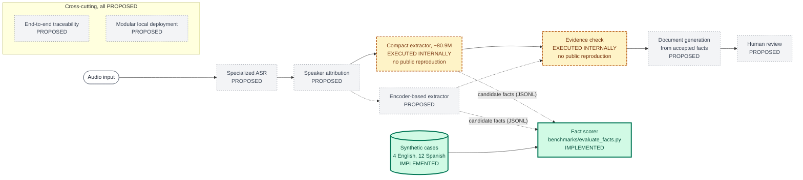

# Reference architecture

The diagram separates three states that are easy to confuse: what is **implemented** in this repository, what was **executed internally** without public reproduction, and what is **proposed** research. Only the fact scorer and its fixtures are implemented here. Everything else is either an internal experiment that cannot be rerun from this repository or a design.

Solid arrows show the intended data flow. Dotted arrows are an alternative path (encoder) or an evaluation tap (scoring candidate facts against reference cases). The status is written in each node so it does not depend on color: green with a heavy border is implemented, dashed amber was executed internally, dotted grey is proposed.

## Status of each component

| Component | Status | What this repository contains |
|---|---|---|
| Fact scorer | Implemented | `benchmarks/evaluate_facts.py` and its tests; see [research note 001](../research/001-structured-fact-evaluation.md) |
| Synthetic cases | Implemented | Four English and twelve Spanish fictional cases with hand-authored predictions |
| Compact extractor | Executed internally | A [model card](../models/model-cards/xerry-extract-010a-e2.md) and a [negative-result note](../research/002-compact-extractor-negative-result.md); no model files |
| Evidence check | Executed internally | Described in note 002; no implementation |
| Specialized ASR, speaker attribution | Proposed | Nothing; interface contract below. A third-party recognition model was run internally on one recording ([note 003](../research/003-one-recording-repeated-runs.md)); no specialized ASR exists |
| Encoder-based extractor | Proposed | Nothing; the comparison is an open question |
| Document generation, human review | Proposed | Nothing; interface contract below |
| Traceability, modular deployment | Proposed | Nothing |

## Interface contract per stage

| Stage | Role | Minimum contract |
|---|---|---|
| Speech recognition | Convert audio to text segments | Model version, language, segment timing, uncertainty signal |
| Speaker attribution | Assign segments to speakers | Speaker labels, overlap handling, uncertainty signal |
| Candidate fact extraction | Propose structured facts from text | Subject, concept, value, polarity, temporality, evidence quote, abstention state |
| Evidence check | Test candidates against the source | Accept or reject with a reason; no silent repair |
| Document generation | Draft from accepted facts only | Accepted facts and source references as the only inputs |
| Human review | Approve, correct, or reject output | Recorded decision and the version reviewed |

The extraction contract is the schema read by the scorer.

## Why separate stages

Separating transcription, speaker attribution, extraction and drafting makes it possible to attribute errors to a stage and to stop when an earlier stage is uncertain. Modularity also adds integration errors and latency, so it is a hypothesis to test against end-to-end systems, not an assumption. A drafting component should use only accepted facts and should not repair missing evidence with plausible text.

## Boundary

This page omits product services, endpoints, production orchestration, device design and customer integrations. It does not describe a deployable system.
